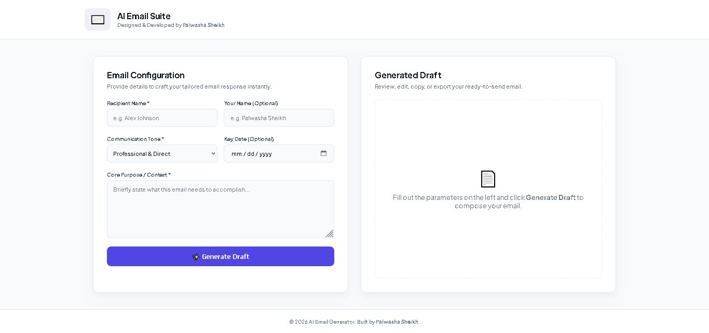
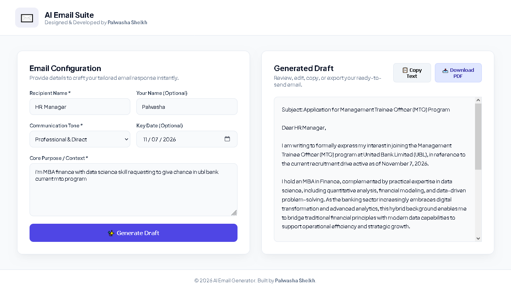
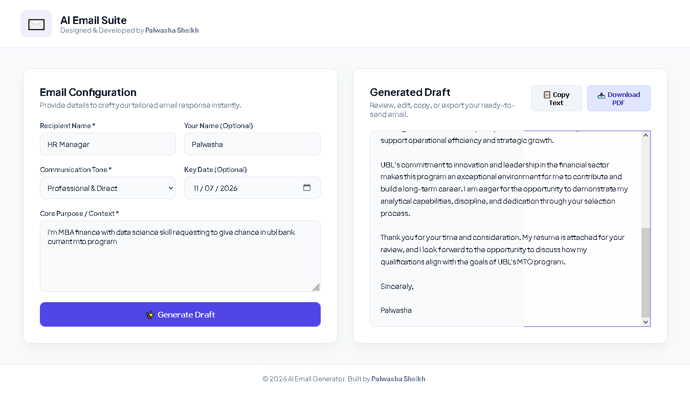

# ✉️ AI Email Generator Pro

An advanced, full-stack web application built with **FastAPI** and the **Google GenAI SDK** (`gemini-3.8-flash`) that instantly crafts professional, tone-specific emails based on user prompts. Designed with a modern dashboard UI, one-click clipboard copying, and PDF export functionality.

---

## ✨ Features

* **AI-Powered Generation:** Leverages Google's advanced `gemini-3.8-flash` model to write context-aware emails.
* **Customizable Tones:** Choose from Professional & Direct, Warm & Friendly, Executive Formal, Persuasive & Sales, Urgent, or Apologetic.
* **Dynamic Date & Signature Support:** Automatically integrates key dates and formats signatures cleanly.
* **Instant Actions:** One-click **Copy Text** with visual confirmation feedback and **Download PDF** export capability via client-side rendering.
* **Modern Dashboard UI:** Fully responsive split-screen layout with an interactive loading state spinner.

---

## 📸 App Screenshots

### 1. Application Home Interface (Empty State)
When you first launch the app, you are greeted with a clean configuration panel ready for your inputs:


### 2. Generated Email Result
Once configured, the AI instantly composes a polished email draft with options to copy or export directly to PDF:


Once configured, the AI instantly composes a polished email draft with options to copy or export directly to PDF:



---

## 🛠️ Tech Stack

* **Backend:** Python, FastAPI, Uvicorn, Jinja2 Templates, `python-multipart`
* **AI Engine:** Google GenAI SDK (`gemini-3.8-flash`)
* **Frontend:** HTML5, CSS3 (Custom Design System with Google Plus Jakarta Sans)
* **Client-Side Libraries:** `html2pdf.js` for instant PDF generation

---

## 📁 Project Directory Structure

```text
AI EMAIL/
│
├── __pycache__/
├── output/                  # Stores application screenshots & exports
│   ├── homepage.png
│   └── generated-email.png
├── static/                  # Static assets
│   └── style.css            # Custom modern stylesheet
├── templates/               # HTML templates
│   └── index.html           # Main dashboard UI
├── venv/                    # Python virtual environment
├── .env                     # Environment variables (API Key)
├── .gitignore
├── main.py                  # FastAPI application backend
└── requirements.txt         # Project dependencies
```

---

## 🚀 Getting Started & Installation

Follow these steps to set up and run the project locally on your machine:

### 1. Clone the Repository
```bash
git clone https://github.com/your-username/ai-email-generator.git
cd AI-EMAIL
```

### 2. Create and Activate a Virtual Environment
```bash
python -m venv venv
# On Windows:
venv\Scripts\activate
# On macOS/Linux:
source venv/bin/activate
```

### 3. Install Dependencies
```bash
pip install fastapi uvicorn google-genai python-dotenv python-multipart jinja2
```

### 4. Set Up Environment Variables
Create a `.env` file in the root directory of your project and add your Google Gemini API key:
```env
GEMINI_API_KEY=your_actual_gemini_api_key_here
```

### 5. Run the Application
Start the FastAPI server using Uvicorn:
```bash
uvicorn main:app --reload
```

Open your browser and navigate to:
👉 **`http://127.0.0.1:8000`**

---

## 💡 Usage Guide

1. Enter the **Recipient Name** (e.g., *HR Manager*).
2. Optionally enter **Your Name** for the closing signature block.
3. Select your desired **Communication Tone** from the dropdown menu.
4. Pick an optional **Key Date** if time sensitivity is required.
5. Provide the **Core Purpose / Context** (e.g., *Applying for the MTO program with a background in finance and data science*).
6. Click **✨ Generate Draft**, review your tailored email, and use the **Copy Text** or **Download PDF** buttons!

---
*Designed & Developed by **Palwasha Sheikh***